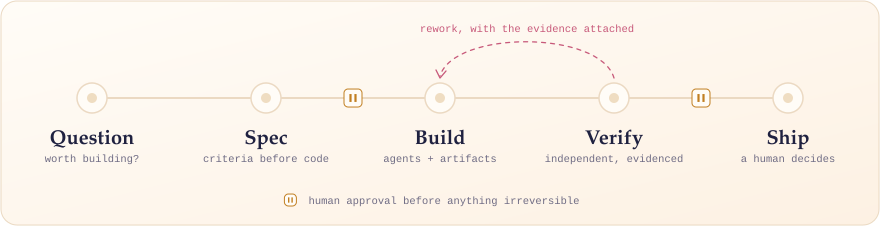
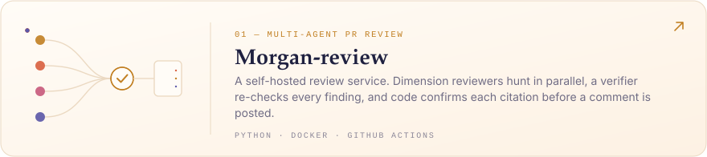
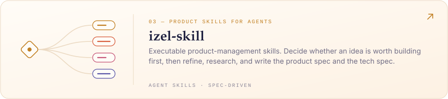
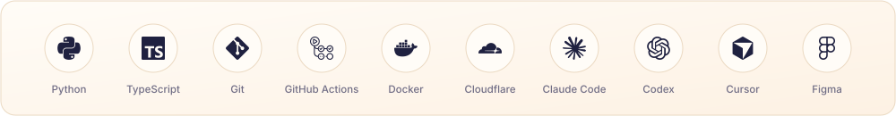
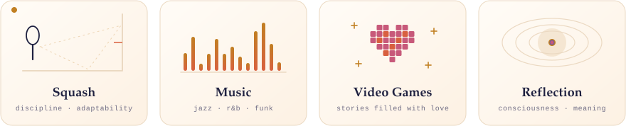

  <picture>
    <source media="(max-width: 600px) and (prefers-color-scheme: dark)" srcset="./assets/banner-mobile-dark.svg" />
    <source media="(max-width: 600px)" srcset="./assets/banner-mobile-light.svg" />
    <source media="(prefers-color-scheme: dark)" srcset="./assets/banner-dark.svg" />
    
  </picture>

  <a href="https://izelzzz.com"><picture><source media="(prefers-color-scheme: dark)" srcset="./assets/link-web-dark.svg" /></picture></a>
  &nbsp;
  <a href="https://x.com/izelzzz"><picture><source media="(prefers-color-scheme: dark)" srcset="./assets/link-x-dark.svg" /></picture></a>
  &nbsp;
  <a href="mailto:965670101@qq.com"><picture><source media="(prefers-color-scheme: dark)" srcset="./assets/link-mail-dark.svg" /></picture></a>

### `whoami`

I'm Izel — a product-minded builder fascinated by the intersection of **AI, software, and human creativity**.

My journey started in product design, evolved through developer tools and engineering management, and is now taking me deeper into AI-native software development.

I'm particularly interested in understanding not just *what AI can do*, but **how to build reliable systems around it**.

I enjoy turning ambiguous ideas into tangible products, questioning assumptions, and figuring out how things work under the hood.

  <picture>
    <source media="(prefers-color-scheme: dark)" srcset="./assets/divider-dark.svg" />
    
  </picture>

### `how_i_work_with_ai`

  <picture>
    <source media="(max-width: 600px) and (prefers-color-scheme: dark)" srcset="./assets/how-i-work-mobile-dark.svg" />
    <source media="(max-width: 600px)" srcset="./assets/how-i-work-mobile-light.svg" />
    <source media="(prefers-color-scheme: dark)" srcset="./assets/how-i-work-dark.svg" />
    
  </picture>

AI writes most of the code I ship. What I own is the system around it — the part that decides whether the output can be trusted.

- **Question before building.** The cheapest feature is the one that never needed to exist. I decide whether an idea is worth doing before I ask how.
- **Criteria before code.** A spec and its acceptance criteria are agreed up front, so "done" is a fact to check rather than a feeling.
- **Artifacts over conversation.** Each agent has one job and hands off through files, not chat history. Context stays small and every step stays auditable.
- **No model grades its own work.** Review comes from a fresh context, ideally a different model, reading only the spec and the diff.
- **Evidence over confidence.** A claim counts when it points at a source line, a test result, or a run. What can't be proven gets said out loud.
- **A human owns the irreversible.** Merging, deploying, and deciding what matters stay with me.

> **Build with AI. Think beyond AI.**

  <picture>
    <source media="(prefers-color-scheme: dark)" srcset="./assets/divider-dark.svg" />
    
  </picture>

### `currently_building`

  <a href="https://github.com/Izelzzz/Morgan-review">
    <picture>
      <source media="(max-width: 600px) and (prefers-color-scheme: dark)" srcset="./assets/project-morgan-review-mobile-dark.svg" />
      <source media="(max-width: 600px)" srcset="./assets/project-morgan-review-mobile-light.svg" />
      <source media="(prefers-color-scheme: dark)" srcset="./assets/project-morgan-review-dark.svg" />
      
    </picture>
  </a>

  <a href="https://github.com/Izelzzz/Eos-workbench">
    <picture>
      <source media="(max-width: 600px) and (prefers-color-scheme: dark)" srcset="./assets/project-eos-workbench-mobile-dark.svg" />
      <source media="(max-width: 600px)" srcset="./assets/project-eos-workbench-mobile-light.svg" />
      <source media="(prefers-color-scheme: dark)" srcset="./assets/project-eos-workbench-dark.svg" />
      
    </picture>
  </a>

  <a href="https://github.com/Izelzzz/izel-skill">
    <picture>
      <source media="(max-width: 600px) and (prefers-color-scheme: dark)" srcset="./assets/project-izel-skill-mobile-dark.svg" />
      <source media="(max-width: 600px)" srcset="./assets/project-izel-skill-mobile-light.svg" />
      <source media="(prefers-color-scheme: dark)" srcset="./assets/project-izel-skill-dark.svg" />
      
    </picture>
  </a>

  <picture>
    <source media="(prefers-color-scheme: dark)" srcset="./assets/divider-dark.svg" />
    
  </picture>

### `stack_and_environment`

  <picture>
    <source media="(max-width: 600px) and (prefers-color-scheme: dark)" srcset="./assets/stack-mobile-dark.svg" />
    <source media="(max-width: 600px)" srcset="./assets/stack-mobile-light.svg" />
    <source media="(prefers-color-scheme: dark)" srcset="./assets/stack-dark.svg" />
    
  </picture>

  <strong>Languages</strong> · Python · TypeScript &nbsp;│&nbsp; <strong>Ship</strong> · Git · GitHub Actions · Docker · Cloudflare &nbsp;│&nbsp; <strong>Workbench</strong> · Claude Code · Codex · Cursor · Figma

  <picture>
    <source media="(prefers-color-scheme: dark)" srcset="./assets/divider-dark.svg" />
    
  </picture>

### `beyond_the_terminal`

Not everything worth exploring happens in front of a screen.

  <picture>
    <source media="(max-width: 600px) and (prefers-color-scheme: dark)" srcset="./assets/beyond-mobile-dark.svg" />
    <source media="(max-width: 600px)" srcset="./assets/beyond-mobile-light.svg" />
    <source media="(prefers-color-scheme: dark)" srcset="./assets/beyond-dark.svg" />
    
  </picture>

- 🏸 **Squash** — A competitive sport that constantly reminds me about discipline, adaptability, and decision-making.
- 🎷 **Music** — Jazz, R&B and Funk. Always looking for interesting rhythms.
- 🎮 **Video Games** — A lover of story-driven games with emotional depth, meaningful characters, and stories filled with love.
- 🌌 **Reflection & Discovery** — Exploring the deeper dimensions of human existence — consciousness, meaning, and the inner world.

  <picture>
    <source media="(prefers-color-scheme: dark)" srcset="./assets/footer-dark.svg" />
    
  </picture>

